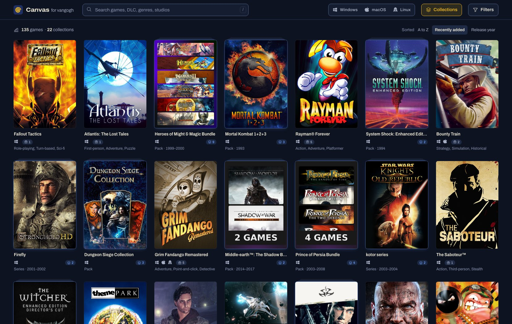
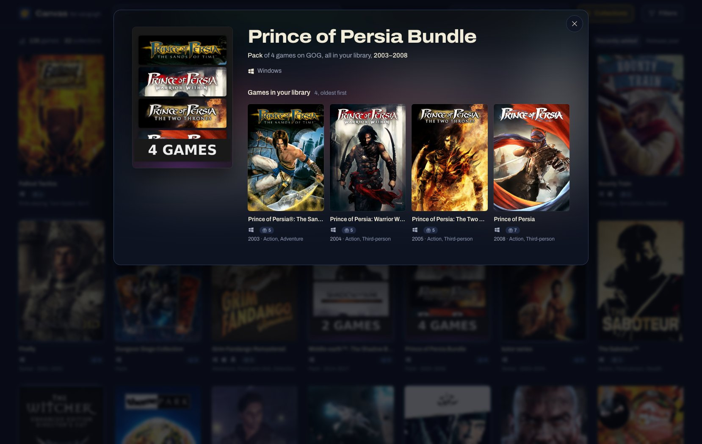
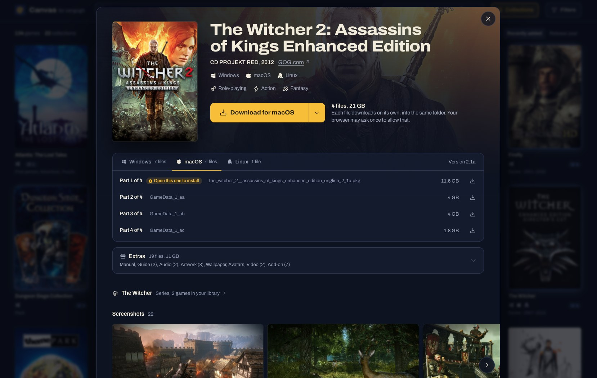
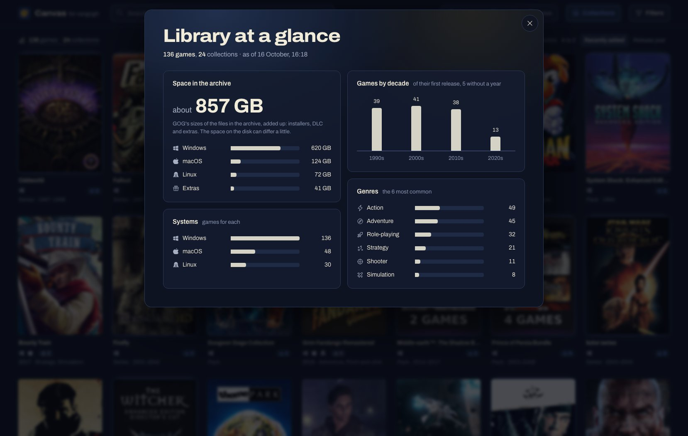

# Canvas

A web frontend for a GOG library archived by
[vangogh](https://github.com/arelate/vangogh). Canvas shows your games as a
wall of posters, searches them as you type, and hands out the installers.
It only reads: syncing and administration stay in vangogh.

| The library, with collections | A collection |
|---|---|
|  |  |

| A game | The library at a glance |
|---|---|
|  |  |

Canvas assumes you follow GOG.com's
[games sharing guidelines](https://support.gog.com/hc/en-us/articles/212184489-Can-I-share-games-with-others-?product=gog).

## What it needs

- Docker.
- vangogh, reachable over HTTP. Tested with vangogh 1.2.20.
- A way to `api.github.com` for the version check, unless you switch it off
  (`VERSION_CHECK=off`).
- A vangogh account of role `user` for Canvas only. It can read the whole
  archive: treat its password like your GOG login and keep vangogh off the
  internet.

## Run it

1. Create the account on vangogh's host:

   ```bash
   docker exec vangogh vangogh users -create -username api -password '<password>' -role user
   docker restart vangogh
   ```

2. Save this as `compose.yml`, with your vangogh's address in `VANGOGH_URL`:

   ```yaml
   services:
     canvas:
       image: ghcr.io/shai66/vangogh-canvas:latest
       container_name: vangogh-canvas
       restart: unless-stopped
       ports:
         - "1854:1854"
       environment:
         VANGOGH_URL: http://vangogh.lan:1853
         VANGOGH_USERNAME: ${VANGOGH_USERNAME:?set VANGOGH_USERNAME in .env}
         VANGOGH_PASSWORD: ${VANGOGH_PASSWORD:?set VANGOGH_PASSWORD in .env}
         SETTINGS_PIN: ${SETTINGS_PIN:-}
       volumes:
         - canvas-cache:/cache
         - canvas-settings:/settings
       read_only: true
       tmpfs:
         - /tmp
       security_opt: ["no-new-privileges:true"]
       cap_drop: ["ALL"]

   volumes:
     canvas-cache:
     canvas-settings:
   ```

   Tags: `latest`, `0.11`, `0.11.0`. amd64 and arm64.

3. Put the account in `.env` next to it (`VANGOGH_USERNAME`,
   `VANGOGH_PASSWORD`). Write a `$` in the password as `$$`, or quote the
   value with single quotes.

4. Start it and check:

   ```bash
   docker compose up -d
   curl http://127.0.0.1:1854/healthz
   ```

   `503` with `"status":"no-index"` until the first rebuild, then `200`
   with `"status":"ok"` and `"login":"ok"`. `"login":"rejected"` means
   vangogh refused the password.

Canvas rebuilds its index at start and then once a day. The container runs
as `node`, read-only, without capabilities, and writes only to the volumes
`canvas-cache` and `canvas-settings` and to `/tmp`.

## Run it next to vangogh

`examples/compose.vangogh-stack.yml` runs vangogh and Canvas in one stack.
vangogh reads its users only at start, so the order matters:

1. Copy it into a folder of its own as `compose.yml`, with the Canvas
   account in `.env` next to it.
2. `docker compose up -d`
3. Create the account and restart both services:

   ```bash
   docker exec vangogh vangogh users -create -username api -password '<password>' -role user
   docker compose restart
   ```

4. Log in to vangogh on port 1853, connect it to GOG and run its sync, as
   vangogh's wiki says. Over plain `http://` from another machine, vangogh
   keeps you logged in only with `VANGOGH_INSECURE-COOKIES=true`: uncomment
   that line and run `docker compose up -d` again before you log in.
5. Canvas saw an empty library at start. Ask it to look again:

   ```bash
   curl -X POST http://127.0.0.1:1854/api/rebuild
   ```

The example keeps vangogh's volumes under `/docker/vangogh`; vangogh's
wiki says which permissions they need. `CANVAS_PORT` in `.env` changes the
port on the host.

## Settings

These settings are environment variables.

| Variable | Meaning | Default |
|---|---|---|
| `VANGOGH_URL` | Address of vangogh, such as `http://vangogh.lan:1853`, without credentials | required |
| `VANGOGH_USERNAME` | The account | required |
| `VANGOGH_PASSWORD` | Its password | required |
| `REBUILD_AT` | Time of the daily rebuild, `HH:MM`. Put it after vangogh's own sync. | `04:30` |
| `TZ` | Time zone of `REBUILD_AT` and of the times Canvas shows | `UTC` |
| `CACHE_DIR` | Folder for the cached index | `/cache` |
| `PORT` | Port inside the container | `1854` |
| `VERSION_CHECK` | `off` stops Canvas asking GitHub once a day whether a newer version is released | `on` |
| `SETTINGS_PIN` | 4 to 8 digits. Turns on the settings page, which it unlocks. Without it, "Settings" in the foot says how to turn them on. | none |
| `SETTINGS_DIR` | Folder for the settings, a volume | `/settings` |

Canvas refuses to start when a required variable is missing, or when
`SETTINGS_PIN` is not 4 to 8 digits, and says why.

## The settings page

Put `SETTINGS_PIN` in `.env` and run `docker compose up -d` again, which
recreates Canvas with it. Then click "Settings" in the foot of the page and
enter the PIN: it unlocks that browser for 30 days, and "Lock" on the page
ends it sooner.

The page holds how the library opens in a browser that has not chosen its
own view (sort order, platforms, collections, Hide 18+), and a switch for
the theo command in a game's detail: `theo install <id>` to copy, for
people who install games with [theo](https://github.com/arelate/theo). A
change is saved at once; other browsers see it when they next load a page.

The settings are kept in `settings.json` in `/settings`. A stack made
before 0.11.0 has neither the volume there nor the PIN's line: add
`canvas-settings:/settings` under `volumes` and
`SETTINGS_PIN: ${SETTINGS_PIN:-}` under `environment`, as in "Run it".
Without the volume Canvas says it cannot save; without the line the PIN in
`.env` never reaches the container. `settings` in `/healthz` says `ok`,
`unwritable`, or `off` without a PIN.

Behind a reverse proxy, let the proxy pass the `Host` header through, or
set `ORIGIN` to the address the browser uses, for example
`ORIGIN=http://canvas.home:1854` (a setting of SvelteKit's Node server).
Otherwise Canvas takes the page's requests for requests from another site:
it refuses to unlock and says so. It refuses in the same way when it was
restarted without `SETTINGS_PIN` while the page was open.

## Extras

Canvas shows a game's extras (manuals, soundtracks, artwork and the rest of
GOG's goodies) when vangogh mirrors them, which it does by default. If you
turned them off with `-no-extras` or `VANGOGH_NO-EXTRAS`:

1. Remove the setting. `false` does not turn them back on.
2. Run `vangogh get-downloads -missing` to fetch the extras of games synced
   before.
3. Wait for Canvas's next rebuild, or trigger one with
   `curl -X POST http://127.0.0.1:1854/api/rebuild`.

## Update it

```bash
docker compose pull canvas
docker compose up -d canvas
curl http://127.0.0.1:1854/healthz     # version shows the new version
```

Name the service, as above, or the example stack pulls and recreates
vangogh too.

Canvas checks GitHub once a day for a newer release and says "Update
available" in the foot of the page, with a link to it. `VERSION_CHECK=off`
stops it; `/healthz` shows the last answer under `update`.

Some versions change the shape of the cached index. After such an update
every page says "The library is being prepared" and `/healthz` answers
`503` for a few seconds, until the first rebuild is done. Don't redeploy
while vangogh's nightly sync runs: if vangogh is down at that moment, Canvas
waits 5, 15 and then 60 minutes before trying again.

A download that is running during a redeploy is cut off. The browser can
resume it.

## Look after it

| Question | Where to look |
|---|---|
| Is it running, how old is the library? | `GET /healthz` |
| Is the cache written? | `cache` in `/healthz`: `written`, `failed` (see the log; the volume may be full or read-only) or `never` (no rebuild yet). |
| What happened during the last rebuild? | The container log: one line per rebuild, skipped record and DLC without its base game. |
| The library looks stale | `rebuild.lastResult` and `rebuild.lastError` in `/healthz`. After `"login":"rejected"` Canvas tries once more after 15 minutes, then waits for the next daily rebuild. |
| vangogh was synced by hand | `curl -X POST http://canvas.lan:1854/api/rebuild` |
| The cache seems broken | Remove the volume `canvas-cache` and redeploy. |

While vangogh restarts around its nightly sync, Canvas keeps serving the
previous index and tries again after 5, 15 and 60 minutes.

The cookie `canvas-view` keeps the platform filter, the sort order,
the collections toggle and the chip Hide 18+. Everything else is in the
address, so a view can be shared as a link.

## Routes

| Route | Returns |
|---|---|
| `GET /` | The library. `?q=`, `?os=`, `?genre=`, `?play=`, `?hide=18`, `?sort=recent` or `?sort=year`, and `?view=collections` choose the view. |
| `GET /game/{id}` | The library with that game open |
| `GET /collection/{id}` | The library with that collection's sheet open |
| `GET /settings` | The library with the settings page open, or the PIN prompt while the browser is locked. `404` without `SETTINGS_PIN`. |
| `GET /api/index` | Every game and collection. The header `x-built-at` gives the time of the last rebuild. |
| `GET /api/games/{id}` | One game in full |
| `GET /img/{imageId}` | A poster or a screenshot |
| `GET /download/{gameId}/{fileId}` | An installer file, resumable |
| `HEAD /download/{gameId}/{fileId}` | 200 when the file can be fetched, 404 or 502 when not |
| `GET /logo` | The logo |
| `GET /healthz` | Status |
| `POST /api/rebuild` | Starts a rebuild: `202`, `409` while one runs, `403` when sent from a page of another site |
| `GET /api/settings` | The settings, to an unlocked browser: `401` while locked |
| `PUT /api/settings` | Saves the settings: `200`, `400` when they are not valid, `401` while locked, `403` when sent from a page of another site, `500` when they cannot be written |
| `POST /api/settings/unlock` | Body `{"pin":"…"}`: `204` with the cookie that unlocks the browser, `401` a second later for a wrong PIN, `403` when sent from a page of another site |
| `POST /api/settings/lock` | Locks the browser again: `204`, `403` when sent from a page of another site |

## Develop

A SvelteKit app on Node 22.18 or newer. The server builds an index of the
library from vangogh's API, caches it, and passes images and downloads
through. All interface text is in `src/lib/strings.ts`, all colours in
`src/lib/styles/tokens.css`.

```bash
npm install
npm run dev                # reads .env
npm test                   # unit tests
npm run test:integration   # the built app against a fake vangogh
npm run test:e2e           # the built app in a browser, against the fake vangogh
npm run check              # types
```

The browser tests need `npx playwright install chromium-headless-shell`
once per machine.

To build the image from the clone, the repository's own `compose.yml`
builds `vangogh-canvas:local` from the Dockerfile:

```bash
cp .env.example .env      # then fill in the account
docker compose up -d --build
```

`node --env-file=.env scripts/capture-samples.ts` saves real responses of
your vangogh to `samples/`, which is not committed. With samples present,
more tests run, checking the mapper and the indexer against your library.
`npm run screenshots -- name=address …` takes this README's pictures from
a running Canvas of the same version as `package.json`.

## Licence

MIT, see `LICENSE`. Canvas is not affiliated with GOG or with vangogh.
